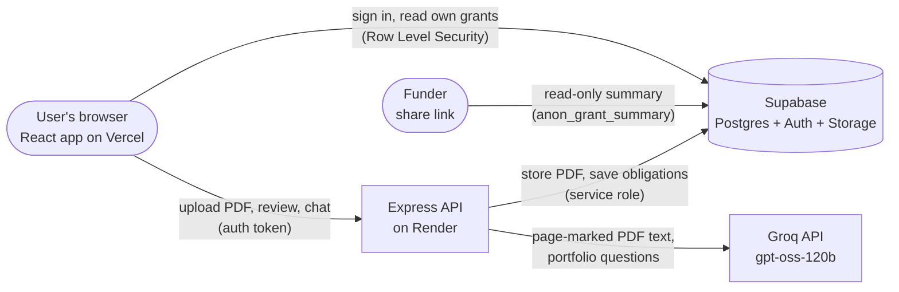

# GrantGuard AI

**Live demo: [grant-guard-ai.vercel.app](https://grant-guard-ai.vercel.app)**

GrantGuard AI turns a grant agreement PDF into a tracked list of compliance obligations, so NGOs never miss a reporting deadline or funding condition.


## The problem

A single grant agreement can run to dozens of pages, and the obligations are scattered through it: quarterly reporting dates, audit requirements, rules on what the money may be spent on, procurement and policy conditions. Small NGOs often manage several grants at once with a spreadsheet and someone's memory. Missing one clause can mean a late report, a disallowed cost, or a funder relationship put at risk.

## What GrantGuard does

1. **Upload.** Add a grant agreement PDF with its name and funder.
2. **AI extracts.** GrantGuard reads the document and pulls out every obligation: deadlines, reporting duties, eligible activities and compliance conditions. Each one keeps the exact clause and page it came from.
3. **Review.** You check each obligation against its source quote, edit anything the AI got wrong, and confirm low-confidence items before anything is tracked.
4. **Track.** Confirmed obligations feed a portfolio dashboard and alerts, so you can see what's due soon across all your grants.

## Features

- **Source quotes for every obligation.** Each extracted item shows the verbatim clause and page number, so you can verify it against the agreement instead of trusting the AI blindly. The original PDF opens alongside it.
- **Confidence flags.** Ambiguous or implied obligations are marked low-confidence and stay flagged until someone reviews them.
- **Portfolio dashboard.** Active grants, obligations due in the next 14 days, flagged clauses, and the health of every grant at a glance.
- **Alerts.** One list of everything across the portfolio that still needs review, filterable by flagged / needs review.
- **Calendar export.** Download dated obligations as an `.ics` file for Google Calendar, Outlook or Apple Calendar, per grant or for the whole portfolio.
- **Ask GrantGuard.** A chat assistant that answers questions about your portfolio ("Which reports are due this week?", "Which obligations are overdue?") using only your own data.
- **Funder share link.** Generate a read-only link that shows a funder the confirmed obligations for one grant. No account needed, no access to the full agreement, and you can revoke it at any time.

## Tech stack

| Layer | Technology |
|-------|------------|
| Frontend | React 19, Vite, Tailwind CSS 4, React Router, react-hot-toast |
| Backend | Node.js, Express, multer (uploads), pdf.js (PDF text extraction) |
| Database, auth and file storage | [Supabase](https://supabase.com): Postgres with Row Level Security, email/password auth, private storage bucket |
| AI | [Groq](https://groq.com) API running `openai/gpt-oss-120b`. Note: **Groq** the inference provider, not xAI's Grok |
| Hosting | Vercel (frontend), Render (backend) |

## Architecture



- **The browser** signs in with Supabase Auth and reads the user's own grants straight from Supabase. Row Level Security makes sure each user only ever sees their own rows.
- **The Express API** does everything that needs a secret: storing the PDF, extracting its text page by page, calling Groq, and saving the obligations. API keys never reach the browser.
- **The funder share page** calls a single locked-down database function that returns only one grant's confirmed obligations for a valid share token.

## Running locally

See **[SETUP.md](SETUP.md)** for step-by-step instructions: creating a Supabase project, running the SQL migrations, getting a Groq key, filling in the `.env` files, and starting the app.

In short, once the `.env` files are filled in:

```bash
npm run install:all
npm run dev
```

## Environment variables

Never commit real values. `.env` files are gitignored; see `backend/.env.example` and `frontend/.env.example`.

| Variable | Where | Purpose |
|----------|-------|---------|
| `SUPABASE_URL` | backend | Supabase project URL |
| `SUPABASE_SERVICE_ROLE_KEY` | backend | Server-side Supabase key that bypasses RLS. Backend only, never expose it |
| `GROQ_API_KEY` | backend | Groq API key for obligation extraction and the chat assistant |
| `MODEL` | backend | Groq model ID (default `openai/gpt-oss-120b`) |
| `CHAT_MODEL` | backend | *(optional)* Separate model for the chat assistant; falls back to `MODEL` |
| `MAX_EXTRACT_CHARS` | backend | *(optional)* Max characters of PDF text sent to the AI, cut at a page boundary (default 40000) |
| `PORT` | backend | Port the API listens on (default 4000) |
| `CORS_ORIGIN` | backend | Frontend origin allowed to call the API (e.g. the Vercel URL) |
| `VITE_SUPABASE_URL` | frontend | Supabase project URL |
| `VITE_SUPABASE_ANON_KEY` | frontend | Public anon / publishable Supabase key (safe in the browser; RLS protects data) |
| `VITE_API_URL` | frontend | Base URL of the Express API |

## Deployment

- **Frontend: Vercel.** The project root is `frontend/`. Set the three `VITE_*` variables in the Vercel project settings. `frontend/vercel.json` routes every path to the single-page app, so deep links like `/s/<token>` work.
- **Backend: Render.** [`render.yaml`](render.yaml) defines a Node web service rooted at `backend/` (`npm install`, then `npm start`). Set `SUPABASE_URL`, `SUPABASE_SERVICE_ROLE_KEY`, `GROQ_API_KEY` and `CORS_ORIGIN` (the Vercel URL) in the Render dashboard. On the free plan the service sleeps after about 15 minutes of inactivity, and the first request afterwards takes 30–60 seconds while it wakes up.
- **Database: Supabase.** Run the SQL files in [`migrations/`](migrations/) in numeric order in the Supabase SQL editor, as described in [SETUP.md](SETUP.md).

## Team

Built by **Grace** ([@SiwaGrace](https://github.com/SiwaGrace)) and **Bismark** ([@HOLYGRILL-7](https://github.com/HOLYGRILL-7)) as our graduation project for **Codetrain Africa**.

Original repository: [github.com/SiwaGrace/GrantGuard_AI](https://github.com/SiwaGrace/GrantGuard_AI)
